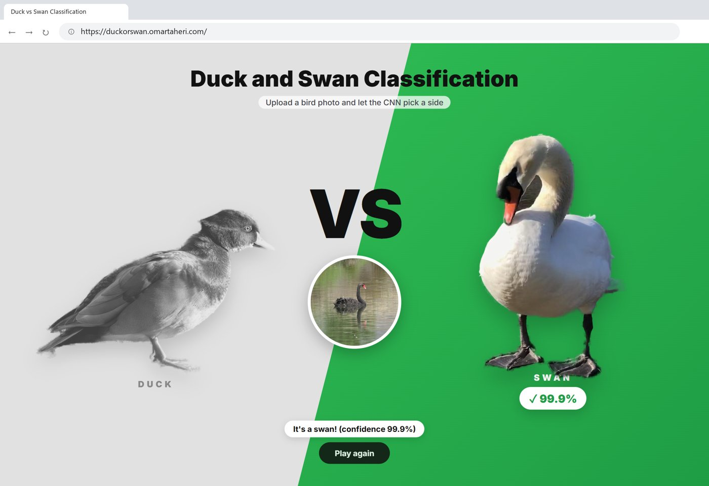

# Duck or Swan? 🦆 vs 🦢

A convolutional neural network (Keras 3) that tells ducks from swans, served as a "Duck vs Swan" web game.
Upload a bird photo: both sides of the page start grey, and the side the CNN picks lights up green with its confidence.

### 🌐 Live demo: [duckorswan.omartaheri.com](https://duckorswan.omartaheri.com)

[](https://duckorswan.omartaheri.com)
*A black swan uploaded to the live site: the CNN picks **Swan** (99.9 %) and that side turns green.*

**Test accuracy: 92.6 %** on 1,500 unseen photos (precision/recall ≈ 92–93 % for both classes).

## Model
| | |
|---|---|
| Input | 224 × 224 RGB, scaled to [0, 1] |
| Architecture | 5 VGG-style blocks (2 × Conv3×3 + BatchNorm + ReLU, MaxPool), 32→256 filters; GlobalAveragePooling; Dropout 0.4; Dense 256 ReLU; Dropout 0.3; Dense 1 sigmoid |
| Parameters | 2.42 M |
| Training | Adam (lr 1e-3, halved on plateau), binary cross-entropy, batch 32, early stopping (patience 15) – best epoch 58 of 73 |
| Augmentation | GPU layer (`app/augment.py`): flip, rotation, zoom, shift, colour jitter, random grayscale. It does nothing at prediction time. |

The random-grayscale augmentation stops the network from using "white bird = swan" as a shortcut,
so black swans and white Muscovy ducks are classified by shape.

## Dataset
10,000 research-grade [iNaturalist](https://www.inaturalist.org) photos (CC0 / CC-BY / CC-BY-NC), 5,000 per class:
- **Ducks:** 9 genera (*Anas, Aythya, Aix, Mareca, Spatula, Cairina, Bucephala, Mergus, Netta*)
- **Swans:** 6 species (*Cygnus olor, cygnus, columbianus, buccinator, atratus, melancoryphus*)

The photos are de-duplicated with perceptual hashing, balanced, and split 70 / 15 / 15.
The dataset is not stored in the repo. Rebuild it with `scripts/download_data.py`.

## Project layout
| Path | What |
|---|---|
| `app/main.py` | FastAPI back-end (`GET /`, `POST /predict`, `GET /health`) |
| `app/augment.py` | Custom GPU augmentation layer (needed to load the model) |
| `app/static/` | Front-end (HTML / CSS / JS + bird cut-outs) |
| `model/duck_swan_model.keras` | Final trained model |
| `scripts/download_data.py` | Download, clean and split the dataset |
| `scripts/train.py` | Training script. It also trains the original lecture CNN as a baseline for comparison. |
| `Dockerfile` | CPU-only image for deployment |

## Run locally
```powershell
python -m venv .venv
.venv\Scripts\Activate.ps1
pip install torch --index-url https://download.pytorch.org/whl/cpu
pip install -r requirements.txt
$env:KERAS_BACKEND = "torch"
uvicorn app.main:app --port 8000
```
Open http://localhost:8000

## Docker
```bash
docker build -t duck-swan .
docker run -p 8000:8000 duck-swan
```

## Deploy on Coolify
1. **New Resource → Application →** this GitHub repository.
2. Set **Build Pack** to **Dockerfile** and **Ports Exposes** to **8000**, then add your domain.
3. Deploy. The image has a built-in health check (`/health`). Inference runs on CPU only (about 0.25 s per image); no GPU is needed.

The live deployment runs at https://duckorswan.omartaheri.com.

## Re-train (NVIDIA GPU)
```powershell
pip install torch --index-url https://download.pytorch.org/whl/cu124
pip install keras matplotlib scikit-learn pillow imagehash requests
python -I scripts/download_data.py inat
python -I scripts/download_data.py build
python -I -u scripts/train.py
```
